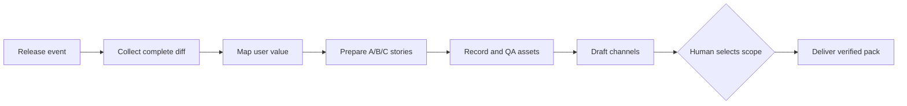

# My Release Skills

> AI release automation skills for Claude Code, Codex, and other agent runtimes.

[English](README.md) · [简体中文](README.zh-CN.md)

## Install / quick start

```text
FOLLOW instructions {repo_path}/prompts/prompt.md
```

Pin a repository revision and load only the helper Skill contracts needed by the current task. Runtime adapters, credentials, and customer evidence stay outside this public distribution. Entry skill: `skills/chatcut-release/SKILL.md`.

**My Release Skills** turns a software release into a verifiable customer-facing delivery:

release diff → user-value shortlist → story candidates → recording/GIF assets → channel drafts → human selection → evidence-backed handoff

It is designed for FDEs, growth engineers, developer advocates, and product teams who need to transform GitHub releases into release notes, email campaigns, social content, demos, and reusable agent workflows.

## What this repository solves

Most release automation stops at “summarize the changelog.” Real work starts after that:

- Which changes are meaningful to a user?
- What user story should the demo show?
- Which claims are actually verified?
- How can an agent prepare several finished options instead of asking an open-ended question and blocking?
- Which actions are drafts, which are reversible preparations, and which require a human decision?
- How do we prove that a GIF, email CTA, or release asset came from the correct source revision?

My Release Skills treats a release as a bundle of tasks and evidence. The agent can prepare the work, but it does not invent a human selection, a conversion result, or a publication receipt.

## Core workflow



The only business decision gate is the feature shortlist. Evidence collection, reversible preparation, validation, and draft generation can continue without pretending that a person has approved the final promotional scope.

## Why “Skills” matter

Anthropic describes Agent Skills as folders of instructions, scripts, and resources that agents can load dynamically for specialized work. This repository applies that pattern to release operations:

| Skill layer | Release operation |
| --- | --- |
| Knowledge | Release policy, writing rules, customer language, evidence boundaries |
| Procedure | Collect diffs, classify user value, create story candidates, record demos |
| Tools | GitHub, Resend read-only analytics, real UI recording, Feishu review, docs PRs |
| Verification | Source coverage, asset hashes, duration/size checks, receipts, repeat-run probes |
| Human boundary | Select the promotional scope; approve irreversible external publication |

## Included capabilities

- Complete GitHub release and PR/commit diff collection
- User-aware feature matrix with source references and unresolved items
- A/B/C story candidate preparation for non-technical stakeholders
- Real UI walkthrough and GIF production contracts
- Resend funnel readout without turning unavailable metrics into zero
- Feishu review handoff with explicit human selection
- Draft generation for email, social channels, changelog, and documentation
- Idempotency, durable checkpoints, source SHA binding, and repeat-run checks
- Evidence-first verification that distinguishes planned, prepared, recorded, sent, and published

## Repository map

- `skills/chatcut-release/SKILL.md` — single public entry point
- `skills/collect-release-diff/` — complete release and PR/commit coverage
- `skills/select-release-features/` — user-value matrix and story candidates
- `skills/select-release/` — the human feature-shortlist handoff
- `skills/record-full-walkthrough/` — full walkthrough, raw MP4, derived GIF, QA
- `skills/create-release-social-cards/` — reviewable visual candidates
- `skills/verify-chatcut-release-skill/` — project-level verification
- `docs/anthropic-knowledge-work-visual.md` — market model and Skill mapping
- Private case study and operational receipts stay in the source repository; the public distribution contains only sanitized Skill contracts

## Design principles

1. **Task first.** Model work as user-visible tasks, not as a list of model prompts.
2. **Evidence before marketing.** A release claim needs source, scope, and verification.
3. **Candidates before questions.** When the agent is authorized to prepare work, deliver comparable finished options before asking a human to choose.
4. **Human choice stays explicit.** A recommendation, webhook delivery, or “GO” is not a selection.
5. **Progressive disclosure.** Load only the skill and references required for the current task.
6. **Draft by default.** External publication, broadcast email, and irreversible actions remain outside the default workflow.
7. **Reuse the real route.** A local mock or API response does not prove the real UI, recorder, or recipient surface.
8. **Private data stays private.** Credentials, sender state, internal receipts, and local paths must not enter a public repository.

## Evidence states

| State | Meaning |
| --- | --- |
| `planned` | A workflow or task is specified |
| `prepared` | Reversible inputs or drafts exist |
| `recorded` | Real media was produced and checked |
| `sent` | A real delivery receipt was read back |
| `published` | The external destination confirms publication |
| `blocked` | A required surface, permission, or fact is unavailable |

Do not collapse these states into “done.”

## Anthropic references

- [Agent Skills](https://www.anthropic.com/engineering/equipping-agents-for-the-real-world-with-agent-skills)
- [Skill authoring best practices](https://docs.anthropic.com/claude/docs/agents-and-tools/agent-skills/best-practices)
- [Building effective agents](https://www.anthropic.com/engineering/building-effective-agents)
- [Anthropic Economic Index](https://www.anthropic.com/economic-index)
- [Claude Skills guide](https://docs.anthropic.com/en/build-with-claude/skills-guide)

## Security and scope

This project prepares release work. It does not silently publish, broadcast, change permissions, bypass platform controls, or treat a human decision as implied. Use minimum permissions, isolated task data, durable audit records, and explicit channel authorization.

The public `my-release-skills` repository is a sanitized distribution. Internal receipts, local machine paths, private account identifiers, credentials, and customer data belong in a private operational repository.

## Search terms

AI release automation, Agent Skills, Claude Code skills, Codex skills, GitHub release automation, release notes automation, product launch workflow, GIF demo generation, release marketing automation, FDE workflow, developer relations automation, Resend email drafts, Feishu release review, MCP release tooling.

## Related projects

- [html-artifacts](https://github.com/liush2yuxjtu/html-artifacts) — Claude skill for interactive HTML artifacts
- [atelier](https://github.com/liush2yuxjtu/atelier) — open-source Claude Design alternative

## License

See [LICENSE](LICENSE).

