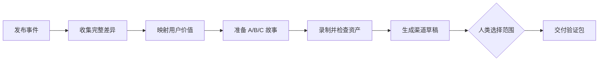

# My Release Skills

> 面向 Claude Code、Codex 与其他 Agent Runtime 的 AI 发布自动化 Skills。

[English](README.md) · [简体中文](README.zh-CN.md)

**My Release Skills** 把一次软件发布变成可验证、可复用、面向客户的交付：

发布差异 → 用户价值筛选 → A/B/C 用户故事 → 真实录屏与 GIF → 邮件/社交渠道草稿 → 人类选择 → 有证据的交付包

这个仓库适合 FDE、增长工程师、开发者关系、产品与营销团队，用来把 GitHub Release 转成 release notes、邮件活动、社交内容、产品演示，以及可以在 Claude Code、Codex 等环境中复用的 Agent Skills。

## 它解决什么问题

“扫描 changelog 并总结”只是开始。真正的发布工作还要回答：

- 哪些改动对用户最有价值？
- 演示应该讲哪个完整的用户故事？
- 哪些结论已经被源代码、真实界面或交付回执验证？
- Agent 能否先准备多个可比较的成品，再让人类选择，而不是停在一个开放问题上？
- 哪些步骤只是草稿，哪些步骤需要明确的人类决定？
- 如何证明 GIF、邮件 CTA 或发布资产来自正确的源版本？

这个仓库把发布建模成“任务 + 证据”的工作包。Agent 可以准备和验证工作，但不会虚构人工选择、转化提升、模型效果或发布回执。

## 核心工作流



业务决策闸门是功能与故事范围的选择。证据收集、可逆准备、验证和草稿生成可以先继续，但系统不会把推荐、Webhook 或“GO”误认为人工已经选择。

## 为什么使用 Skills

Anthropic 将 Agent Skills 描述为一组可按需加载的 instructions、scripts 和 resources，用于专门任务。这个仓库把同一模式应用到发布工作：

| Skill 层 | 发布工作 |
| --- | --- |
| 知识 | 发布政策、写作规则、客户语言、证据边界 |
| 流程 | 收集差异、判断用户价值、生成用户故事、录制演示 |
| 工具 | GitHub、Resend 只读分析、真实界面录制、Feishu 评审、文档 PR |
| 验证 | 源覆盖、资产哈希、时长/大小检查、回执、重复运行探针 |
| 人类边界 | 选择宣传范围；批准不可逆的外部发布 |

## 能力清单

- 完整收集 GitHub Release、PR 与 commit 差异
- 带源引用和未解决项的用户价值矩阵
- 面向非技术利益相关方的 A/B/C 用户故事候选
- 真实 UI walkthrough、原始 MP4、派生 GIF 与质量检查契约
- 读取 Resend funnel 数据；缺失指标保持为未知，不强行写成零
- 通过 Feishu 交互卡片完成显式的人类选择
- 生成邮件、社交渠道、changelog 和文档草稿
- 幂等性、持久化检查点、源 SHA 绑定和重复运行检查
- 区分 planned、prepared、recorded、sent、published、blocked 的证据优先验证

## 快速开始

```text
FOLLOW instructions {repo_path}/prompts/prompt.md
```

独立使用时，请固定仓库 revision，只加载当前任务需要的 Skill 契约。运行时适配器、凭证、内部回执和客户数据不属于这个公开分发包。

## 仓库结构

- `skills/chatcut-release/SKILL.md` — 公开入口
- `skills/collect-release-diff/` — 完整 release 和 PR/commit 覆盖
- `skills/select-release-features/` — 用户价值矩阵与故事候选
- `skills/select-release/` — 人类功能范围选择
- `skills/record-full-walkthrough/` — walkthrough、MP4、GIF 与 QA
- `skills/create-release-social-cards/` — 可评审的视觉候选
- `skills/verify-chatcut-release-skill/` — `/verify` 项目级验证契约
- `docs/anthropic-knowledge-work-visual.md` — Anthropic 知识工作模型与 Skill 映射
- 私有案例和运行回执留在源仓库；公开仓库只发布脱敏后的 Skill 契约

## 设计原则

1. **任务优先。** 按用户可见任务建模，而不是堆一组 prompt。
2. **证据优先于营销。** 每个发布主张都需要来源、范围和验证。
3. **先给候选，再提问题。** 在授权准备工作时，先交付可比较的选项。
4. **人类选择必须显式。** 推荐、Webhook 或“GO”不等于选择。
5. **渐进式加载。** 只加载当前任务所需的 Skill 和参考资料。
6. **默认草稿。** 外部发布、群发邮件和不可逆操作不在默认流程内。
7. **复用真实路径。** 本地 mock 或 API 返回不能证明真实 UI、录制器或收件人界面。
8. **私有数据保持私有。** 凭证、发送状态、内部回执和本机路径不能进入公开仓库。

## 证据状态

| 状态 | 含义 |
| --- | --- |
| `planned` | 已定义工作流或任务 |
| `prepared` | 已生成可逆输入或草稿 |
| `recorded` | 已生成并检查真实媒体 |
| `sent` | 已读回真实发送回执 |
| `published` | 外部目标确认已发布 |
| `blocked` | 所需界面、权限或事实不可用 |

不要把这些状态压缩成一个“完成”。

## Anthropic 参考

- [Agent Skills](https://www.anthropic.com/engineering/equipping-agents-for-the-real-world-with-agent-skills)
- [Skill authoring best practices](https://docs.anthropic.com/claude/docs/agents-and-tools/agent-skills/best-practices)
- [Building effective agents](https://www.anthropic.com/engineering/building-effective-agents)
- [Anthropic Economic Index](https://www.anthropic.com/economic-index)
- [Claude Skills guide](https://docs.anthropic.com/en/build-with-claude/skills-guide)

## 安全与范围

这个项目用于准备和验证发布工作。它不会静默发布、群发、修改权限、绕过平台控制，也不会把人类决定当成默认同意。请使用最小权限、隔离任务数据、持久化审计记录和明确的渠道授权。

公开的 `my-release-skills` 是脱敏分发。内部回执、本机路径、私有账号标识、凭证和客户数据应保留在私有运行仓库。

## 搜索关键词

AI 发布自动化、Agent Skills、Claude Code Skills、Codex Skills、GitHub Release 自动化、release notes 自动化、产品发布工作流、GIF 演示生成、发布营销自动化、FDE 工作流、开发者关系自动化、Resend 邮件草稿、Feishu 发布评审、MCP 发布工具。

## License

见 [LICENSE](LICENSE)。
