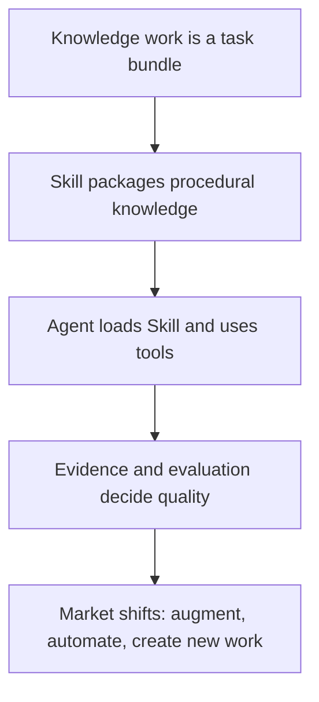

# Anthropic Knowledge Work → My Release Skills

This model combines three official Anthropic ideas:

1. **Agent Skills** package instructions, scripts, and resources that agents load dynamically for specialized work.
2. **Effective agents** depend on good tools, clear orchestration, and evaluations rather than prompts alone.
3. **Economic Index / scenarios** model work as tasks that can be augmented, automated, or replaced by new tasks.

## Mapping to release work

| Anthropic concept | My Release Skills implementation |
| --- | --- |
| Task bundle | Release diff, user-value interpretation, story design, recording, QA, copy, delivery |
| Skill | A versioned folder of instructions, scripts, references, and contracts |
| Tool use | GitHub, Resend read-only data, real UI recorder, Feishu review, docs PR |
| Evaluation | Source coverage, exact revision, asset hash, duration/size, repeat-run and receipt checks |
| Human boundary | Explicit feature shortlist; no implied approval |
| New work | Verification, permissions, audit, failure recovery, and multi-party coordination |

## The FDE lesson

The valuable capability is not “ask an AI to make a video.” The valuable capability is:

- discover what the business actually means by “make a video”;
- turn a feature into a user story with an observable result;
- prepare multiple finished candidates so a stakeholder chooses efficiently;
- preserve authorization and evidence;
- turn the proven workflow into a reusable Skill;
- only then consider hosted orchestration and more channels.

This is a conceptual mapping. It does not claim that every Anthropic capability is implemented here, and it does not claim that the ChatCut case produced conversion uplift.

